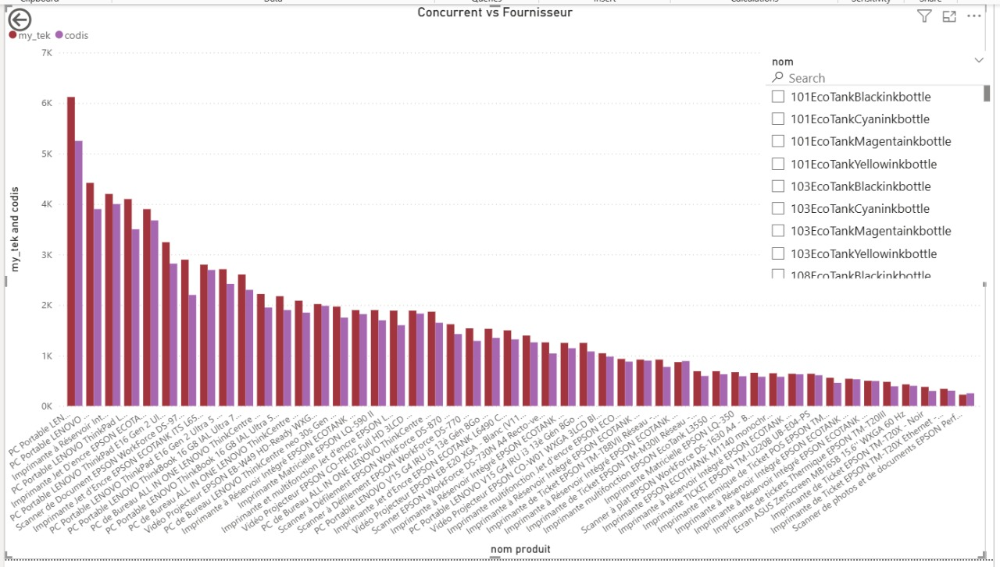
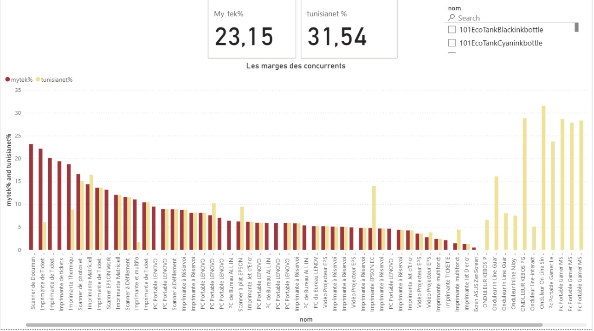
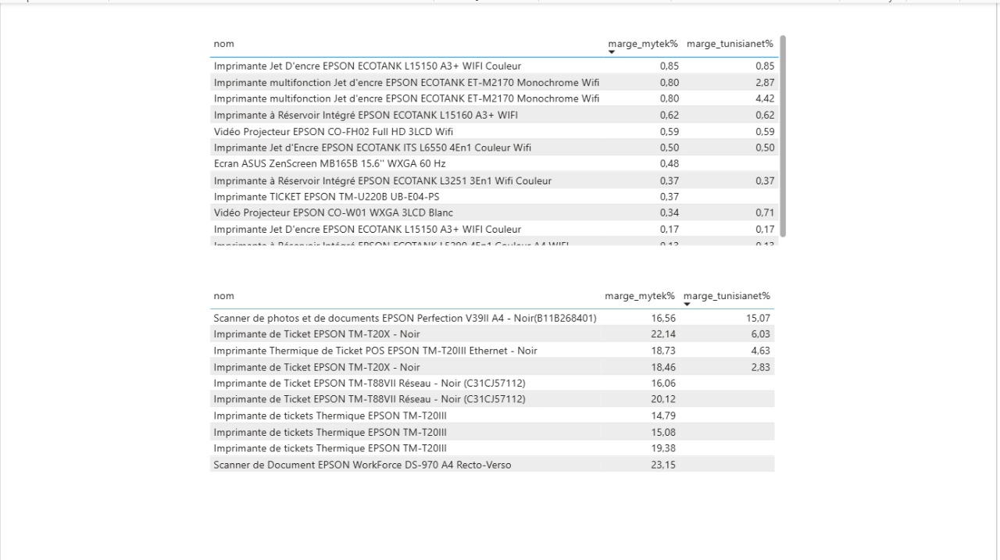

# Gestion devis Maktabi

Projet réalisé pendant mon stage chez Maktabi. Le but est de suivre les prix des concurrents (Mytek et Tunisianet) et du fournisseur Codis, de calculer les marges possibles sur chaque produit et de les afficher dans un rapport Power BI.

## Comment ça marche

Le script tourne en trois étapes, une fois par jour :

1. `concurrents` : scrape les prix et la disponibilité des produits sur Mytek et Tunisianet, et ajoute les nouveaux produits trouvés dans les catégories suivies.
2. `codis` : lit dans la boîte mail les tableaux de prix envoyés par Codis et les ajoute au catalogue du jour.
3. `marges` : nettoie les prix, calcule les marges et prépare le fichier lu par Power BI.

## Structure du projet

```
Gestion_devis_Maktabi/
├── run.py                  lance les étapes
├── maktabi/
│   ├── config.py           chemins des fichiers
│   ├── concurrents.py      étape 1
│   ├── codis.py            étape 2
│   └── marges.py           étape 3
├── data/
│   ├── catalogue_base.xlsx catalogue de départ
│   ├── daily/              fichiers du jour (étapes 1 et 2)
│   ├── cleaned/            fichiers après nettoyage (étape 3)
│   ├── codis/              données brutes extraites des mails
│   └── powerbi/            table utilisée par Power BI
├── reports/
│   ├── powerbi.pbix
│   └── captures/
├── docs/                   notes et liste de choses à faire
├── requirements.txt
└── .env.example
```

Les dossiers `daily`, `cleaned`, `codis` et `powerbi` sont recréés à chaque lancement, ils ne sont pas dans git.

Le catalogue `catalogue_base.xlsx` contient plusieurs feuilles : les catégories (Sheet1), les sous-catégories (Sheet2), les pages à scraper (SSC), les produits (Sheet3), les attributs (Sheet4) et leurs valeurs par produit (Sheet5).

## Installation

Il faut Python 3.12.

```
py -3.12 -m venv .venv
.venv\Scripts\activate
pip install -r requirements.txt
copy .env.example .env
```

Ensuite il faut remplir le fichier `.env` avec l'adresse Gmail qui reçoit les mails de Codis et un mot de passe d'application Gmail (à créer sur https://myaccount.google.com/apppasswords). Le mot de passe normal du compte ne marche pas.

## Utilisation

```
python run.py all
python run.py concurrents
python run.py codis
python run.py marges
```

`all` lance les trois étapes dans l'ordre. Pour refaire une étape sur un autre jour, on ajoute la date : `python run.py codis --date 28-08-2025`.

Les étapes 2 et 3 ont besoin du fichier créé par l'étape 1 à la même date.

## Résultats

Le rapport Power BI compare le prix chez Codis (le prix d'achat) avec le prix de vente chez Mytek et Tunisianet. La marge est calculée comme ça :

```
marge % = |1 - (prix concurrent TTC / 1,07) / prix Codis| x 100
```

Les produits avec une marge au-dessus de 35 % ne sont pas gardés dans le rapport.

### Concurrent vs fournisseur



Ce graphique met côte à côte le prix Mytek et le prix Codis pour chaque produit, du plus cher au moins cher. Mytek est presque toujours plus cher que Codis. L'écart le plus grand est sur les PC portables Lenovo, environ 6 100 DT chez Mytek contre 5 250 DT chez Codis. Sur quelques produits moins chers, Codis est au même prix ou un peu au-dessus de Mytek.

### Marges des concurrents



Marge de Mytek et de Tunisianet sur chaque produit. Les deux cartes en haut affichent 23,15 % pour Mytek et 31,54 % pour Tunisianet.

Pour la plupart des produits vendus par les deux sites, les marges sont proches, entre 1 et 15 %. Chez Mytek, les marges les plus hautes sont sur les scanners et les imprimantes de tickets Epson (18 à 23 %). Chez Tunisianet, elles sont sur des produits que Mytek ne vend pas, comme les onduleurs et les PC portables gamer MSI, jusqu'à environ 31 %.

### Produits à marge faible et à marge forte



Le tableau du haut liste les produits dont la marge est sous 1 % : imprimantes Epson EcoTank, vidéoprojecteurs Epson et écran ASUS ZenScreen. Les concurrents les vendent presque au prix Codis, donc il n'y a presque rien à gagner dessus.

Le tableau du bas liste les marges les plus fortes : imprimantes de tickets Epson TM-T20 et TM-T88, et scanners Epson, entre 15 et 23 % chez Mytek. Sur ces produits, Maktabi peut se placer en dessous des concurrents et garder une marge.
